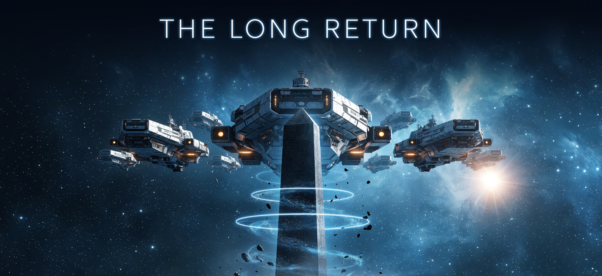
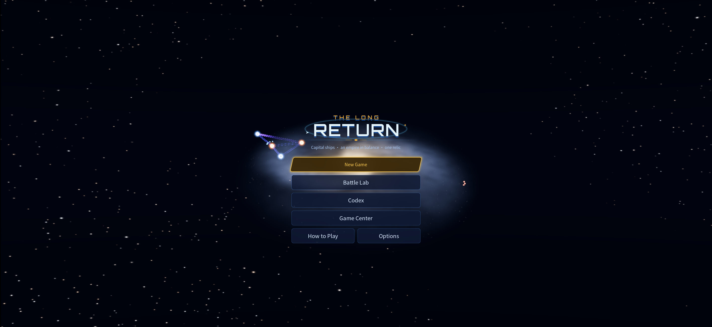
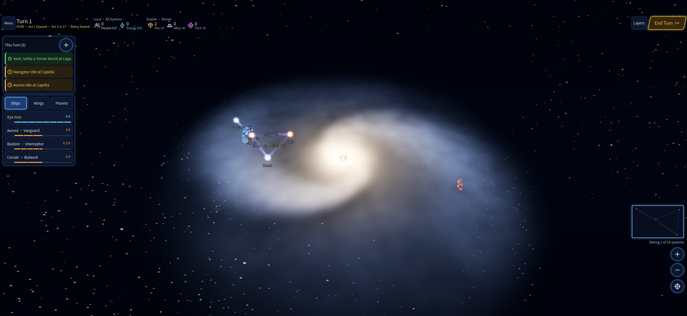
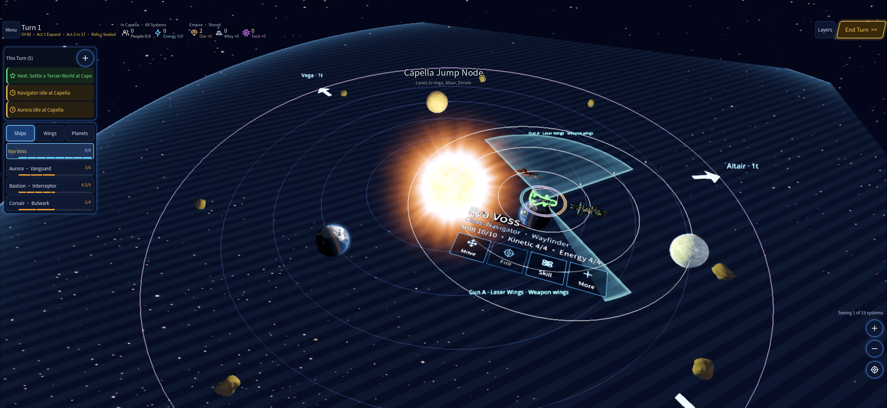
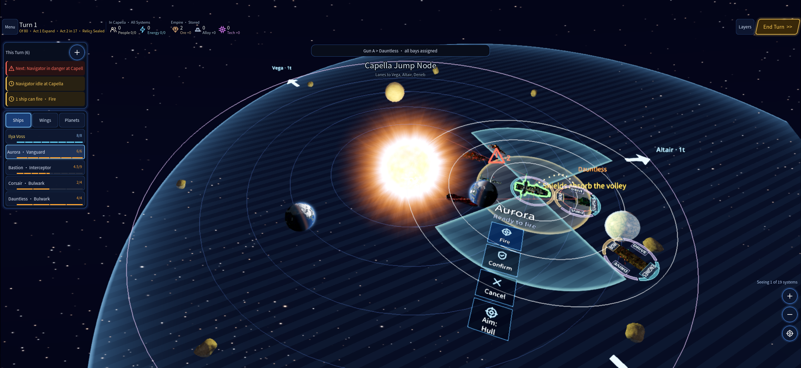

# The Long Return — Support, Privacy & Marketing

A phone-first, turn-based space strategy game: six capital classes, an interstellar economy, one ancient relic, and a road that only runs one way.

**This repository is not the game.** It is the public web presence for The Long Return: the marketing page, the privacy policy, and the place to report problems. The game itself is closed source and is not part of this repository.

---

## Pages

| | |
|---|---|
| **Marketing page** | <https://chanliu1983.github.io/spacefight-site/> |
| **Privacy policy** | <https://chanliu1983.github.io/spacefight-site/privacy.html> |

Both pages are single static files. No cookies, no trackers, no external requests, no fonts pulled from anywhere.

---

## Reporting a problem

**Open an issue:** <https://github.com/chanliu1983/spacefight-site/issues/new>

**You may submit issues in either English or Chinese / 您可以使用中文或者英文提交反馈**

There is no language switch on GitHub Issues, and there does not need to be one — write whichever language is easier. Every issue is read.

GitHub also lets you write an issue in the interface of your choice from the "…" menu, but plain English or plain Chinese text is perfectly fine and is usually faster.

### What to include

The more of this you give, the faster the answer:

1. **Version** — the build number at the bottom of the title screen.
2. **Platform** — iPhone model and iOS version.
3. **What you did**, and **what happened instead**.
4. **A screenshot or a short screen recording**, if it is a visual problem.
5. **The match seed**, if you can find it — the map is generated from it, and the same seed reproduces the same galaxy. It is shown in the New Game panel.

### Before you file it

A few things that look like bugs but are the rules working:

- **The relic only scores while you hold it.** A degree of charge is one turn of occupation, uncontested, with no enemy in the system. Standing next to it is not holding it.
- **Your Navigator is the empire.** Lose it and your empire is stranded on the road for good; there is no rebuild. Everything else is replaceable.
- **Shadows cover you.** A ship in a planet's shadow can only be targeted from close range, and so can you only hit what is in the open.
- **Standing still is how you hit.** A long-range shot has to travel, and a moving ship is harder to hit — but it also cannot shoot while turning hard.

---

## Screenshots

The App Store product-page captures live in [`/screenshots`](screenshots) — 2868×1320 PNGs, the size Apple wants for iPhone. The marketing page uses lighter JPEG re-encodes under [`/assets`](assets) so the page stays quick.

<!-- prettier-ignore -->
| | |
|---|---|
|  |  |
| The splash: the fleet returns to the relic, and the road it came back on. | The title screen: your empire, the modes, and the language switch. |
|  |  |
| The galaxy: explored stars, their lanes, and what you can reach next. | A system: capitals around their planets, the sheet below, and the orders on the right. |
|  | |
| Broadside, bow arc, and the damage log — every shot, with what it hit. | |

The Game Center artwork (two leaderboards and five achievements, 1024×1024) lives in [`/game_center`](game_center). The marketing stills and the gameplay video live in [`/marketing`](marketing).

---

## The game in one paragraph

The Long Return is a phone-first, turn-based strategy game about positioning, logistics, and fleet composition. Six capital classes have real roles: the flexible Vanguard, the area-denial Controller, the fast Interceptor, the long-range Lancer, the durable Bulwark, and the planet-breaking Siege. Settle complementary worlds, balance their people and their energy, recover ancient ship designs from buried cores, and decide when to expand, defend, or raid. Nothing is one-sided: kinetic turrets fire in every direction but reload, laser broadsides only cover the flanks, plasma bows need the target dead ahead, and planetary shadows cover what stands in them. There are three ways to win — hold the ancient relic until it is charged, destroy a rival's Navigator, or lead on score when the last turn arrives — and one thing that must never happen: losing your own Navigator, because that empire is stranded on the road forever. Standard matches run to eighty turns with three acts; Quick matches are half as long and start with a fleet. English and Chinese, offline against the AI, with optional Game Center sign-in for achievements, two leaderboards, and 1v1 auto-match or friend invitations.

© 2026 Lei Liu. All rights reserved.

---

# 漫长归途 —— 支持、隐私与官网

一款为手机设计的回合制太空策略游戏：六种主力舰、一套星际经济、一台远古遗迹，以及一条只朝一个方向走的路。

**这个仓库不是游戏本体。** 它是《漫长归途》的公开网页门面：官网、隐私政策，以及提交问题的地方。游戏本体不开源，也不包含在这个仓库里。

---

## 页面

| | |
|---|---|
| **官网** | <https://chanliu1983.github.io/spacefight-site/> |
| **隐私政策** | <https://chanliu1983.github.io/spacefight-site/privacy.html> |

两个页面都是单文件静态网页。没有 Cookie，没有统计代码，不请求任何外部资源，连字体都是本地的。

---

## 反馈问题

**提交 issue：** <https://github.com/chanliu1983/spacefight-site/issues/new>

**您可以使用中文或者英文提交反馈。**

GitHub 的 issue 没有语言切换，但也不需要 —— 用哪种语言顺手就写哪种，每一条都会有人看。

### 请附上这些信息

信息越全，回复越快：

1. **版本号** —— 标题界面底部的构建号。
2. **设备** —— iPhone 机型与 iOS 版本。
3. **你做了什么**，以及**实际发生了什么**。
4. **截图或一小段录屏**，如果是画面问题。
5. **对局种子**，如果你找得到 —— 星图由它生成，同一个种子会重现同一片星区。它显示在「新的对局」面板里。

### 有几件事看着像 bug，其实是规则在起作用

- **遗物只有你占着才算数。** 一度电荷 = 连续占住一回合、没有敌人在那个星系。停在旁边不等于占住。
- **领航舰就是帝国。** 领航舰没了，你的帝国就永远留在了路上，没有重建这一说。别的都可以重来。
- **阴影能藏住你。** 处在行星阴影里的船，只能被近距离锁定；你也只能打暴露的目标。
- **要打中就得停下来。** 远程弹丸飞过去需要时间，而移动中的船更难被命中 —— 但它也没法一边猛转一边开火。

---

## 截图

App Store 商品页截图在 [`/screenshots`](screenshots)：2868×1320 的 PNG，正是 Apple 要的 iPhone 尺寸。官网页面用的是 [`/assets`](assets) 里重新编码的轻量 JPEG，页面才够快。

游戏中心用的美术（两个排行榜、五项成就，1024×1024）在 [`/game_center`](game_center)。宣传图和实机视频在 [`/marketing`](marketing)。

---

## 游戏，一段话

《漫长归途》是一款为手机设计的回合制策略游戏，讲的是阵型、后勤与舰队编成。六种主力舰各有实打实的职责：什么都能补一点的先锋舰、划线不打仗的控场舰、先到先回信的截击舰、只打远的那一个的长枪舰、站在那儿等你先累的壁垒舰，以及把行星犁开的攻城舰。殖民不同类型的行星，平衡它们的人口与能量，从埋藏的核心里挖回古老舰船的设计图，并在扩张、防守还是突袭之间做决定。没有哪个选择是一边倒的：全向动能炮四面都能打但要装填，激光侧舷只护两舷，等离子舰艏要求目标在正前方，而行星阴影能藏住站在里面的东西。赢法有三种 —— 把远古遗迹充到足够亮、击毁对手的领航舰，或者在最后一回合到来时点数领先 —— 而有一件事绝不能发生：失去自己的领航舰，因为那个帝国就永远留在了路上。标准对局打满八十回合、三个幕次；快速对局时长减半，开局就带着一支舰队。中英文，离线可玩；登录游戏中心可以解锁成就、两个排行榜，以及一对一自动匹配和好友邀请。

© 2026 Lei Liu. All rights reserved.

